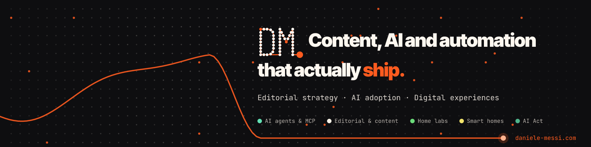

I'm **Daniele Messi**. I run editorial and digital programs at STMicroelectronics in Geneva, and on the side I build what I write about: AI agents and MCP servers, a Proxmox home lab, Home Assistant automations. The guides live at **[daniele-messi.com](https://daniele-messi.com)**.

### What's here

| Project | What it does |
|---|---|
| [astro-content-engine](https://github.com/danymexi/astro-content-engine) | Open-source content pipeline for Astro blogs: bilingual generation, keyword targeting, preview images, scheduled publishing |
| [homelab-automation-blueprints](https://github.com/danymexi/homelab-automation-blueprints) | Home Assistant blueprints: solar and battery optimizer, EV charging, energy cost tracking, climate control |
| [proxmox-homelab-scripts](https://github.com/danymexi/proxmox-homelab-scripts) | Proxmox VE automation: LXC provisioning, Cloudflare Tunnel, a local AI stack, backups |

### Contributing to

[eufy-sdk](https://github.com/mega-yfue/eufy-sdk) and its Home Assistant integration [ha-eufy-sdk](https://github.com/mega-yfue/ha-eufy-sdk): a WebRTC command transport for the HomeBase S1 Pro, the HomeBase alarm as sensors, siren support for the HomeBase 3, and a migration guide from eufy_security.

### Elsewhere

[Writing](https://daniele-messi.com/en/blog/) · [Work](https://daniele-messi.com/en/work/) · [About](https://daniele-messi.com/en/about/) · [LinkedIn](https://www.linkedin.com/in/daniele-messi/)
